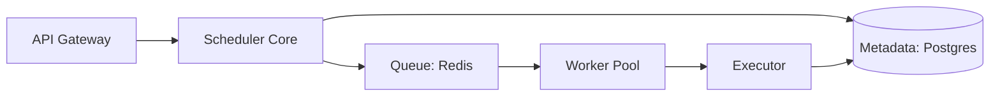

# 分布式任务调度系统 · 设计手册

> **版本**：v1.4.0  
> **状态**：~~草案~~ → *评审中*  
> **维护者**：[平台基础组](mailto:infra@example.com)  
> **仓库**：<https://github.com/example/scheduler>

本文档同时充当 **Markdown 语法特性演示**：所有内容既是一份真实可用的设计文档，也尽量覆盖了常见 Markdown 语法与其渲染行为。不同渲染器（GitHub、Obsidian、Typora、VS Code）支持程度略有差异，文中已做标注。

---

## 目录

1. [项目概述](#1-项目概述)
2. [理论模型](#2-理论模型)
3. [系统架构](#3-系统架构)
4. [核心实现（Rust）](#4-核心实现rust)
5. [部署与运维](#5-部署与运维)
6. [附录](#6-附录)

---

## 1. 项目概述

### 1.1 背景

随着离线计算任务规模增长，旧的 Cron 单机方案在**吞吐量**、*可观测性*、***故障恢复*** 方面逐渐力不从心。我们决定重写调度核心，目标是支撑 ~~十万级~~ **百万级** 任务实例。

### 1.2 设计目标

#### 1.2.1 功能需求

- **任务编排**
  - DAG 依赖解析
  - 失败重试与超时熔断
  - 优先级抢占
- **资源调度**
  - 按 CPU / 内存 / GPU 多维打分
  - 亲和性与反亲和性
- **可观测性**
  - 指标、日志、链路追踪

#### 1.2.2 非功能需求

1. 单集群调度延迟 P99 < 50 ms
2. 支持水平扩展至 1000 个 Worker
3. 元数据存储最终一致
   1. 允许秒级抖动
   2. 不允许丢任务
4. 灰度发布可回滚

##### 1.2.2.1 容量与延迟

根据压测结果，调度器单实例可处理 `12,000 QPS`，对应约 **8 万** 个并发任务实例。

###### 1.2.2.1.1 补充说明

> 以上数字基于 16 vCPU / 32 GiB 的机型，开启 `jemalloc` 与 `io_uring`。

### 1.3 术语表

| 术语 | 英文 | 含义 |
|:-----|:-----|:-----|
| 任务 | Task | 最小可执行单元，对应一次进程启动 |
| 实例 | Instance | 任务的一次运行，拥有唯一 `instance_id` |
| Worker | Worker | 执行任务的物理或虚拟节点 |
| 槽位 | Slot | Worker 上可分配的资源份额，通常为 1 核 |

---

## 2. 理论模型

### 2.1 排队论基础

我们使用 **Little 定律** 估算系统在稳态下的平均并发数：

$$
L = \lambda W
$$

其中 $L$ 为系统中的平均任务数，$\lambda$ 为到达率（任务/秒），$W$ 为平均停留时间（秒）。行内形式为 $L = \lambda W$。

系统利用率定义为：

$$
\rho = \frac{\lambda}{c\,\mu}
$$

为保证稳定性，需满足 $\rho < 1$，否则队列长度将无界增长。

### 2.2 Amdahl 定律

并行化收益受串行部分制约：

$$
S(n) = \frac{1}{(1-p) + \dfrac{p}{n}}
$$

当 $p = 0.95$、$n = 16$ 时，$S(16) \approx 9.14$。

### 2.3 多行公式

$$
\begin{aligned}
\rho &= \frac{\lambda}{c\mu} \\
W_q &\approx \frac{\rho}{1-\rho} \cdot \frac{1}{c\mu} \\
P_{99} &\approx W_q \cdot \ln\frac{1}{0.01}
\end{aligned}
$$

> [!NOTE]
> 上述近似适用于 M/M/c 模型；真实负载存在突发性，建议乘以 1.5 的安全系数。

---

## 3. 系统架构

### 3.1 架构图


用 Mermaid 描述数据流（部分渲染器支持）：



### 3.2 组件职责

| 组件 | 职责 | 技术栈 | 关键指标 |
|:-----|:-----|:-------|--------:|
| API Gateway | 鉴权、限流、路由 | Rust + Axum | `p99 < 5ms` |
| Scheduler Core | DAG 解析、打分、派发 | Rust + Tokio | `QPS 12k` |
| Queue | 任务缓冲与去重 | Redis Stream | `lag < 1s` |
| Worker Pool | 执行任务、上报状态 | Rust + gRPC | `500 节点` |
| Metadata | 持久化与查询 | PostgreSQL 15 | `99.99%` |

### 3.3 调度算法对比

| 算法 | 复杂度 | 公平性 | 适用场景 | 结论 |
|:-----|:------:|:------:|:---------|:-----|
| FIFO | $O(1)$ | 低 | 同构任务 | ❌ |
| 加权轮询 | $O(n)$ | 中 | 多租户 | ⚠️ |
| DRF | $O(n \log n)$ | 高 | 异构资源 | ✅ 采用 |
| 遗传算法 | $O(n^2)$ | 高 | 离线批处理 | ❌ 过重 |

> 说明：表中竖线需写作 `\|` 才能在单元格内显示，例如 `a \| b`。

### 3.4 关键设计决策

> **决策 D-01：为什么不用 Kubernetes 原生调度器？**
>
>> 原生调度器面向 Pod 粒度，抽象层级过低，难以表达任务级重试语义。
>>
>> 但我们 **复用** 了它的以下能力：
>> - 节点注册与心跳
>> - 资源画像（Node Allocatable）
>> - 污点与容忍
>
> 结论：自研调度核心 + K8s 做底层资源池。

---

## 4. 核心实现（Rust）

### 4.1 任务定义

```rust
use serde::{Deserialize, Serialize};
use std::time::Duration;

/// 一个可被调度的任务单元
#[derive(Debug, Clone, Serialize, Deserialize)]
pub struct Task {
    pub id: String,
    pub priority: u8,
    pub cpu_millicores: u32,
    pub memory_mib: u64,
    pub retry: RetryPolicy,
    pub depends_on: Vec<String>,
}

#[derive(Debug, Clone, Serialize, Deserialize)]
pub struct RetryPolicy {
    pub max_attempts: u32,
    pub backoff: Duration,
}

impl RetryPolicy {
    /// 指数退避：base * 2^attempt
    pub fn delay(&self, attempt: u32) -> Duration {
        self.backoff * 2u32.saturating_pow(attempt.min(6))
    }
}
```

### 4.2 调度器骨架

```rust
use tokio::sync::mpsc;
use std::collections::BinaryHeap;

pub struct Scheduler {
    ready: BinaryHeap<Task>,
    tx: mpsc::Sender<Task>,
}

impl Scheduler {
    /// 主循环：取出最高优先级任务并派发
    pub async fn run(mut self) {
        loop {
            match self.ready.pop() {
                Some(task) => {
                    if let Err(e) = self.tx.send(task).await {
                        tracing::error!(error = %e, "dispatch failed");
                        break;
                    }
                }
                None => tokio::task::yield_now().await,
            }
        }
    }
}
```

### 4.3 代码说明

- 使用 `BinaryHeap` 维护就绪队列，`Task` 需实现 `Ord`，复杂度为 $O(\log n)$。
- 行内代码中含有反引号时，可用双反引号包裹：`` `Task::new()` ``。
- 带语言与标题的围栏（部分渲染器支持）：

```rust title="src/lib.rs" {linenos=true}
pub fn health() -> &'static str { "ok" }
```

---

## 5. 部署与运维

### 5.1 上线检查清单

- [x] 压测报告已归档
- [x] 数据库迁移脚本已评审
- [ ] 灰度 5% 流量观察 24h
- [ ] 回滚演练
- [ ] 告警规则接入值班

### 5.2 混合列表

1. **准备环境**
   - 安装 Rust `1.78+`
   - 配置 `~/.cargo/config.toml`

   然后执行：

   ```bash
   cargo build --release
   cargo test --all-features
   ```

2. **启动服务**

   ```bash
   RUST_LOG=info ./target/release/scheduler --config ./conf/prod.toml
   ```

   > 提示：首次启动会自动执行迁移。

3. **验证**

   - `curl localhost:8080/healthz` 返回 `200`
   - 指标端点在 `/metrics`

### 5.3 常用操作

| 操作 | 命令 |
|:-----|:-----|
| 查看队列积压 | `curl -s :8080/metrics \| grep queue_lag` |
| 手动触发重试 | `schedctl retry --task-id <id>` |
| 摘除节点 | `schedctl drain --node <host>` |

使用 <kbd>Ctrl</kbd> + <kbd>C</kbd> 可优雅退出（会等待在途任务完成）。

### 5.4 常见问题

<details>
<summary>点击展开：为什么任务一直处于 Pending？</summary>

可能原因：

1. 依赖的上游任务失败且未配置 `continue_on_failure`
2. 资源画像不足，调度器打分为负
3. 节点被打了 `NoSchedule` 污点

排查：查看 `scheduler_decisions_total{reason="insufficient_resource"}`。
</details>

<details>
<summary>点击展开：如何调整公平性权重？</summary>

修改 `conf/fairness.toml` 中的 `tenant_weight`，热加载生效，无需重启。
</details>

---

## 6. 附录

### 6.1 链接类型

- 行内链接：[Rust 官网](https://www.rust-lang.org "Rust 语言官网")
- 引用式链接：[Tokio][tokio]
- 自动链接：<https://docs.rs/tokio>
- 邮箱：<infra@example.com>
- 锚点跳转：[回到理论模型](#2-理论模型)
- 图片引用式：![徽章][badge]

### 6.2 转义字符

以下字符可被反斜杠转义：`\*`、`\_`、`\#`、`\[`、`\]`、`\|`、`\\`、`` \` ``。

例如 `\*不是斜体\*` 会渲染为 \*不是斜体\*。

### 6.3 换行行为

同一段落内换行不会产生新行，除非行尾加两个空格，  
像这样（上一行末尾有两个空格）。

也可以使用行尾反斜杠\
强制换行（GFM 扩展）。

### 6.4 特性覆盖清单

| 特性 | 语法示例 | 本文位置 | 支持度 |
|:-----|:---------|:---------|:------:|
| 六级标题 | `###### h6` | §1.2.2.1.1 | ✅ |
| 粗/斜/粗斜 | `**b**` `*i*` `***bi***` | §1.1 | ✅ |
| 删除线 | `~~del~~` | §1.1 | ✅ |
| 高亮 | `==mark==` | 见下 | ⚠️ 扩展 |
| 上/下标 | `x^2^` `H~2~O` | 见下 | ⚠️ 扩展 |
| 有序/无序/嵌套 | `1.` `-` | §1.2.1 | ✅ |
| 待办列表 | `- [x]` | §5.1 | ✅ |
| 引用与嵌套引用 | `>` `>>` | §3.4 | ✅ |
| 行内/块公式 | `$..$` `$$..$$` | §2 | ⚠️ 扩展 |
| 表格与对齐 | `:---:` | §3.2 | ✅ |
| 代码块 | ` ```rust ` | §4 | ✅ |
| 脚注 | `[^1]` | 见文末 | ✅ |
| HTML 内嵌 | `<kbd>` `<details>` | §5.3 §5.4 | ✅ |
| 分隔线 | `---` | 见下 | ✅ |
| 任务列表交互 | 勾选框 | §5.1 | ✅ |

补充演示：==高亮文本==、H~2~O、$E = mc^2$、x^2^、<mark>HTML 高亮</mark>、<sub>sub</sub>、<sup>sup</sup>。

---

分隔线演示：

---

### 脚注

正文里的脚注引用写作 `[^1]`，渲染为上标。[^1]

[^1]: 本文档所有性能数据均来自 2024 年 Q3 内部压测环境，仅供容量规划参考。

[tokio]: https://tokio.rs "Tokio 异步运行时"
[badge]: https://img.shields.io/badge/status-review-yellow "状态徽章"